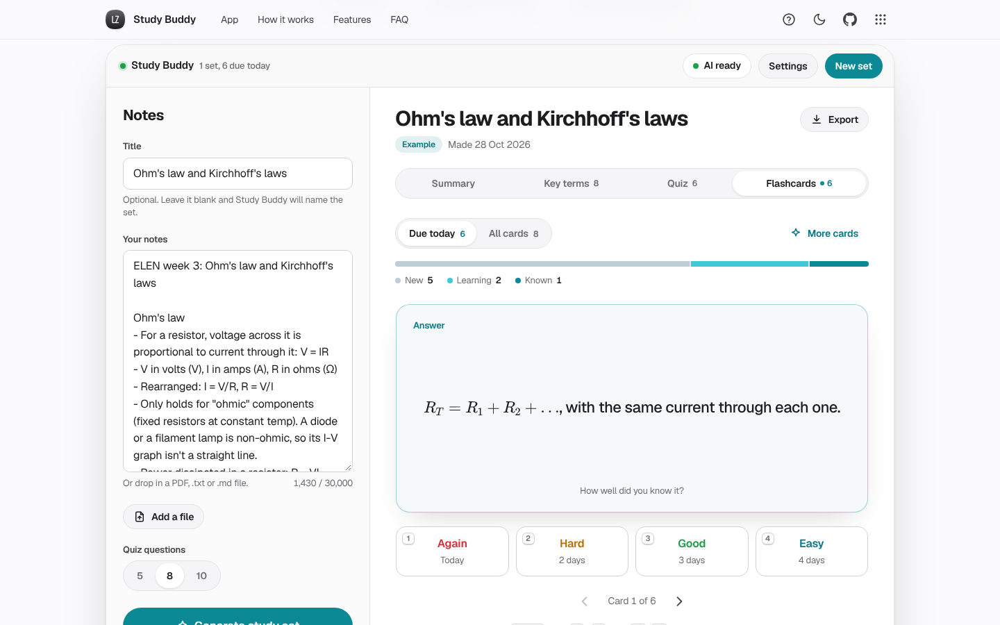

# Study Buddy

Turn lecture notes or a PDF into a summary, key terms, a quiz and flashcards that schedule themselves.

[](https://lz-study-buddy.pages.dev/)

Mirror: https://lazarzec18.github.io/study-buddy-ai/



## Features

**Notes in**
- Paste text, or drop in a PDF, .txt or .md file. PDFs are read in the browser with pdf.js, with the page and character count shown so you can check it worked.
- Optional title, a live 30,000-character counter with one-click trim, and a choice of 5, 8 or 10 quiz questions.
- A progress view while the AI works: reading notes, writing summary, listing key terms, building quiz (with a live question count), making flashcards. Stop at any time.

**Study**
- Summary: a short overview, then key points grouped under headings.
- Key terms: a list that filters as you type.
- Quiz: multiple choice with instant feedback and an explanation for every answer, a score ring at the end, Review mistakes, Retry wrong ones and New attempt (shuffled).
- Flashcards: a 3D flip (a simple swap with reduced motion), Again, Hard, Good and Easy with the next interval shown on each button, a due-today count and a new / learning / known bar per set.
- Keyboard: Space flips, 1 to 4 rate, arrow keys move between cards; 1 to 4 or A to D answer quiz questions and Enter moves on.
- Maths renders with KaTeX everywhere: summary, terms, quiz and cards.
- Regenerate any part from the same notes: rewrite the summary, new key terms, new questions or more cards.

**Library**
- Every set is saved on your device with its date, card count, cards due today and best quiz score.
- Rename, delete with undo, and export to Anki (tab-separated .txt) or Markdown.

**AI, three ways**
- AI ready: the hosted API on Cloudflare Pages, no key needed.
- Your key: bring your own Anthropic key (saved only in this browser, sent only to api.anthropic.com).
- Demo mode: no AI at all, and the Ohm's law and Kirchhoff's laws example set still works fully.

## How it works

The browser sends only `{notes, mode}` to a Cloudflare Pages Function at `/api/study`. The function holds the system prompt and strict JSON schema, calls Anthropic's Messages API with streaming on, and pipes the server-sent events straight back. It limits each IP to 6 requests a minute in memory and 40 a day when a KV namespace is bound, and only answers the site itself, its preview deployments, the GitHub Pages mirror and localhost. While the reply streams in, the client watches which JSON keys have appeared (`"summary"`, `"terms"`, `"quiz"`, `"flashcards"`) and counts questions as they arrive, which drives the progress list without a second request.

Models don't always return clean JSON, so the parser strips code fences and stray prose, removes trailing commas, and repairs LaTeX whose backslashes weren't escaped (in JSON, `\frac` is a form feed followed by "rac"). If the reply still can't be read, Study Buddy asks once more with a short reminder before showing an error.

Flashcards use a lighter SM-2. Again puts a card back in today's queue and lowers its ease; Good goes 1 day, 3 days, then the previous interval times the ease; Hard and Easy shorten or stretch the gap and nudge the ease. Days are local calendar days, so a card rated Good tonight is due tomorrow morning, not in exactly 24 hours.

## Hosting the AI

1. In the Cloudflare dashboard, open Workers and Pages, then the Pages project **lz-study-buddy**, then Settings, then Variables and Secrets.
2. Add `ANTHROPIC_API_KEY` as a **secret** (Production, and Preview if you want previews to work). Optionally add `ANTHROPIC_MODEL` (defaults to `claude-haiku-5-5`).
3. Optional daily limit: create a KV namespace (for example `study-buddy-rate`) and bind it to the project as **`RATE_KV`** under Settings, then Bindings. Without it, only the per-minute limit applies.
4. Redeploy. `GET /api/study` returns `{"ok": true, "configured": true}` once the key is set; without a key, `POST` returns `503 {"error": "not_configured"}` and the site falls back to your-key or demo mode.

The same steps work from the command line:

```sh
npx wrangler pages secret put ANTHROPIC_API_KEY --project-name lz-study-buddy
```

## Tech

- Vanilla HTML, CSS and JavaScript (ES modules), no build step
- Zec Labs design kit (`zl.css`, `zl.js`) with Geist from Google Fonts
- Cloudflare Pages Functions for the hosted API, optional Workers KV for the daily limit
- Anthropic Messages API with streaming (Claude Haiku 5.5 by default)
- KaTeX 0.16.11 and pdf.js 3.11.174 from CDNs
- localStorage for sets, schedules, scores and drafts

## Run locally

```sh
python3 -m http.server
```

Then open http://localhost:8000. A static server has no `/api/study`, so the app runs in your-key or demo mode. To run the hosted API locally, use `npx wrangler pages dev .` with `ANTHROPIC_API_KEY` in a `.dev.vars` file.

## Project structure

| File | What it does |
| --- | --- |
| `index.html` | Page structure: hero, app, how it works, features, FAQ, dialogs |
| `styles.css` | App styles on top of the kit |
| `app.js` | UI: notes input, generation and progress, tabs, quiz, flashcards, library, settings, tour |
| `api.js` | AI routes (hosted, your key, demo) and the SSE stream reader |
| `prompt.js` | The study prompt and schema for your-key mode (kept identical to the server's) |
| `parse.js` | JSON extraction, repair and validation, plus stream progress |
| `srs.js` | SM-2-lite scheduling, due counts and interval labels |
| `files.js` | .txt, .md and PDF reading (pdf.js, loaded on first use) |
| `exporters.js` | Anki and Markdown export, file download |
| `render.js` | Safe Markdown-lite and KaTeX rendering |
| `example.js` | The Ohm's law and Kirchhoff's laws example set |
| `functions/api/study.js` | Cloudflare Pages Function: prompt, limits, CORS and streaming proxy |
| `zl.css`, `zl.js` | Shared Zec Labs kit |
| `_headers` | Cloudflare Pages security and cache headers |

## Testing

The suite lives outside the repo (`tests/study-buddy-ai/`).

- `function.test.mjs` (Node, mocked `fetch`): `GET` configured status, `503 not_configured`, `400` for oversized notes, bad mode, empty notes and bad JSON, `429` after 6 requests a minute and after 40 a day with a fake KV, the success path streaming the SSE body through with the right model, headers and `max_tokens`, CORS and `OPTIONS`, upstream error mapping, and that `prompt.js` matches the server prompt.
- `test.py` (Python Playwright, Chromium) mocks `/api/study` and the Anthropic SSE stream and drives the app with real clicks and keys: fenced JSON with raw LaTeX and a trailing comma, the retry on unreadable JSON, the progress UI, quiz scoring with Review mistakes, Retry wrong ones and New attempt, the SM-2 schedule (Good on a new card is due tomorrow, Again is due today), keyboard flip, rate and navigation, PDF text extraction from a generated two-page PDF, .md upload, validation and rate-limit errors, own-key mode with the direct-browser-access header, Forget key, library rename, delete with undo, Anki and Markdown export content, persistence across reloads, demo mode with no key, reduced motion, every tour step, 390px layout with no horizontal overflow, and no console errors throughout.

---

Part of Zec Labs, a set of small, polished web apps by [Lazar Zec](https://github.com/LAZARZEC18). See them all at https://lazarzec.pages.dev/
